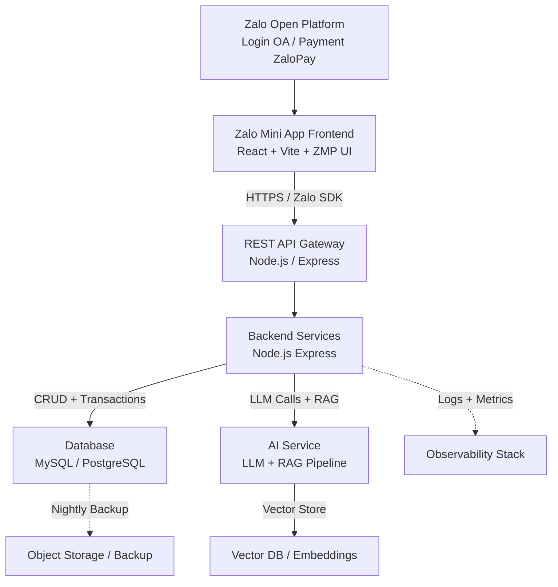
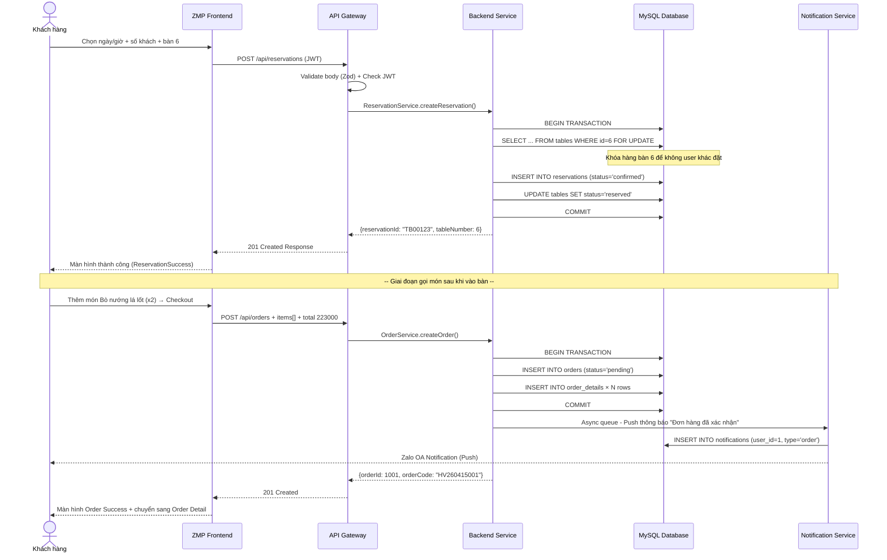
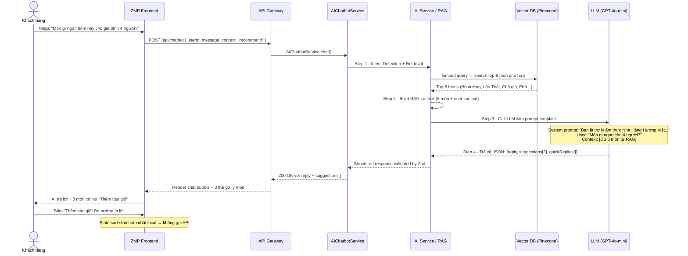

# Kiến trúc hệ thống Nhà Hàng Hương Việt

## Mục lục

- [1. Tổng quan kiến trúc](#1-tổng-quan-kiến-trúc)
- [2. Sơ đồ khối kiến trúc](#2-sơ-đồ-khối-kiến-trúc)
- [3. Chi tiết từng lớp](#3-chi-tiết-từng-lớp)
  - [3.1 Frontend Zalo Mini App](#31-frontend-zalo-mini-app)
  - [3.2 REST API Gateway Layer](#32-rest-api-gateway-layer)
  - [3.3 Backend Services Layer](#33-backend-services-layer)
  - [3.4 Database Layer](#34-database-layer)
  - [3.5 AI Service Layer](#35-ai-service-layer)
  - [3.6 Observability & DevOps](#36-observability--devops)
- [4. Luồng dữ liệu nghiệp vụ](#4-luồng-dữ-liệu-nghiệp-vụ)
  - [4.1 Luồng đặt bàn & gọi món](#41-luồng-đặt-bàn--gọi-món)
  - [4.2 Luồng AI Chatbot gợi ý món](#42-luồng-ai-chatbot-gợi-ý-món)
- [5. Tích hợp bên ngoài](#5-tích-hợp-bên-ngoài)

---

## 1. Tổng quan kiến trúc

Hệ thống **Nhà Hàng Hương Việt** được thiết kế theo kiến trúc 3 lớp (3-tier architecture) kết hợp hướng dịch vụ (service-oriented), tối ưu cho môi trường Zalo Mini App (ZMP). Kiến trúc này tách biệt rõ ràng giữa trình bày, logic nghiệp vụ và lưu trữ dữ liệu, giúp dễ dàng mở rộng và bảo trì.

**Nguyên tắc thiết kế:**
- **Mobile-first:** Tất cả API và luồng đều được tối ưu cho Zalo Mini App với network chậm.
- **Stateless Backend:** Mỗi request độc lập, dễ dàng scale ngang.
- **Caching everywhere:** Redis cache cho dữ liệu tần suất cao (thực đơn, nhà hàng).
- **JWT Authentication:** Token-based auth, không cần session server.
- **Event-driven Notifications:** Sử dụng queue cho việc push thông báo không đồng bộ.

Các thành phần chính:

| Lớp | Công nghệ | Vai trò |
|---|---|---|
| Frontend | React + Vite + ZMP UI | Giao diện người dùng Zalo Mini App |
| API Gateway | Node.js / Express | Route, JWT, rate-limit, validation |
| Backend Services | Node.js / Express | Logic nghiệp vụ đặt bàn, gọi món, AI |
| Database | MySQL 8.0 / PostgreSQL | Lưu trữ dữ liệu quan hệ 10 bảng |
| AI Service | LLM + RAG Pipeline | Trợ lý ẩm thực thông minh |
| Vector DB | Pinecone / pgvector | Embeddings & tìm kiếm ngữ nghĩa món ăn |
| Observability | Winston + Prometheus + Grafana | Log, Metrics, Tracing |
| Backup | Object Storage (S3) | Backup dữ liệu hàng đêm |

---

## 2. Sơ đồ khối kiến trúc



**Giải thích các mũi tên:**

| Loại đường | Ý nghĩa |
|---|---|
| Nét liền (→) | Luồng yêu cầu / phản hồi đồng bộ HTTP |
| Nét đứt (-.→) | Luồng không đồng bộ, background job |

---

## 3. Chi tiết từng lớp

### 3.1 Frontend Zalo Mini App

**Công nghệ:** React 18 + Vite 5 + Zalo Mini Program SDK + ZMP UI Components

**Vai trò:**
- Render giao diện người dùng trên nền tảng Zalo Mini App
- Quản lý trạng thái nội bộ (giỏ hàng, đặt bàn, auth)
- Cache dữ liệu ở client để giảm latency
- Tích hợp Zalo SDK: đăng nhập OAuth, thanh toán ZaloPay, chia sẻ OA

**Quản lý trạng thái (State Management):**

| Thư viện | Mục đích |
|---|---|
| **Zustand** | Global stores: `auth.store`, `cart.store`, `reservation.store`, `notification.store` |
| **React Query (TanStack Query)** | Server state caching, background refetch, stale data cho các API `/restaurants`, `/foods`, `/orders` |

**Cache & Performance:**
- Dùng React Query với `staleTime: 5 phút` cho dữ liệu thực đơn, nhà hàng
- Dùng Zustand persist (localStorage của ZMP) cho giỏ hàng offline
- Image lazy loading với format WebP + responsive srcset

### 3.2 REST API Gateway Layer

**Công nghệ:** Node.js 20 LTS + Express.js 4.x

**Vai trò:**
- Entry point duy nhất cho mọi request từ ZMP Frontend
- Xác thực & phân quyền JWT middleware
- Rate limiting chống spam / brute-force
- Input validation với **Zod** schema validator
- Request logging, CORS, helmet security headers

**Middleware pipeline:**
```
Request → Helmet → CORS → Morgan Log → Rate Limiter → JWT Auth → Zod Validate → Route Handler
```

**Key middleware cấu hình:**
- **express-rate-limit:** 100 req / 15 phút / IP (endpoint auth: 5 req / phút)
- **jsonwebtoken:** Verify token 24h, refresh token 7 ngày
- **helmet:** Security headers (CSP, X-Frame-Options, HSTS)
- **zod:** Validate body / query / params trước khi vào service

### 3.3 Backend Services Layer

**Công nghệ:** Node.js / Express, tách module theo domain theo kiến trúc *Domain-Driven Design (DDD) lite*.

**Các module dịch vụ chính:**

| Module | Vai trò | API liên quan |
|---|---|---|
| **AuthService** | Xác thực Zalo OAuth, OTP SMS, cấp JWT | `/api/auth/login` |
| **RestaurantService** | Lấy danh sách nhà hàng theo khoảng cách (Haversine formula) | `/api/restaurants` |
| **MenuService** | Lọc, phân trang món ăn theo danh mục, trạng thái | `/api/foods` |
| **ReservationService** | Kiểm tra bàn trống, tạo đặt bàn, quản lý trạng thái | `/api/reservations` |
| **OrderService** | Tính tiền đơn hàng, quản lý trạng thái đơn 6 bước, transaction ACID | `/api/orders` (GET, POST) |
| **NotificationService** | Push thông báo qua Zalo OA Message, lưu vào bảng notifications | `/api/notifications` |
| **AIChatbotService** | Orchestrator gọi AI Service, aggregate data gợi ý món | `/api/chatbot` |

**Transaction & Concurrency:**
- Đặt bàn & tạo đơn hàng dùng **MySQL InnoDB transaction** với `SELECT ... FOR UPDATE` để khóa hàng, tránh 2 user đặt cùng 1 bàn / 1 món đã hết.
- OrderService tạo `orders` + `order_details` trong cùng 1 transaction, rollback nếu có lỗi.

### 3.4 Database Layer

**Công nghệ:** MySQL 8.0 InnoDB (hoặc PostgreSQL 15+)

**Vai trò:**
- Lưu trữ bền vững dữ liệu quan hệ (10 bảng chính)
- Đảm bảo ACID transaction cho nghiệp vụ đặt bàn / thanh toán
- Index tối ưu cho các truy vấn phức tạp

**Chi tiết 10 bảng (xem chi tiết tại `docs/02-schema.sql`):**

| STT | Tên bảng | Chức năng | Rows ước tính |
|---|---|---|---|
| 1 | `users` | Người dùng ứng dụng | 50.000 |
| 2 | `restaurants` | Các chi nhánh Hương Việt | 15 |
| 3 | `categories` | Danh mục món ăn | 8 |
| 4 | `foods` | Thực đơn món ăn | 200 |
| 5 | `tables` | Bàn ăn theo chi nhánh | 300 |
| 6 | `reservations` | Phiếu đặt bàn | 200.000 / năm |
| 7 | `orders` | Phiếu đơn hàng | 500.000 / năm |
| 8 | `order_details` | Chi tiết món trong đơn | 2.500.000 / năm |
| 9 | `notifications` | Thông báo người dùng | 3.000.000 / năm |
| 10 | `promotions` | Chương trình KM | 200 |

**Tối ưu:**
- Tất cả khóa ngoại đều có **INDEX** (đã tạo trong schema.sql)
- Partition bảng `orders`, `reservations` theo `created_at` theo tháng (sau khi > 1M record)
- Full-text search trên bảng `foods` (field `name`, `description`, `ingredients`)

### 3.5 AI Service Layer

**Công nghệ:** LLM + RAG (Retrieval-Augmented Generation) Pipeline

**Vai trò:**
- Xử lý yêu cầu chat tự nhiên của user
- Trả lời câu hỏi, tư vấn & gợi ý món cá nhân hóa
- RAG truy xuất chính xác món ăn từ thực đơn

**Kiến trúc AI Service:**

| Thành phần | Công nghệ | Vai trò |
|---|---|---|
| **LLM Model** | GPT-4o-mini / Claude-3-Haiku | Tạo text phản hồi tự nhiên, parse ý định người dùng |
| **Embedding Model** | text-embedding-3-small (OpenAI) / ViTeBERT | Chuyển món ăn, mô tả → vector semantic |
| **Vector DB** | Pinecone / pgvector (extension PostgreSQL) | Lưu vector embedding, tìm kiếm top-k món phù hợp |
| **RAG Pipeline** | LangChain / LlamaIndex JS | Retrieve relevant foods → Build context prompt → Call LLM → Parse structured suggestions |

**Quy trình RAG:**
1. **Index phase:** Mỗi món ăn (name, description, ingredients, price, badge) được embedding thành 1536-dim vector và lưu vào Vector DB.
2. **Query phase:** User gửi tin nhắn "Món ít cay cho 2 người có gì ngon?"
3. **Retrieve:** Query embedding → tìm top-5 món phù hợp theo ngữ nghĩa (ít cay, giá hợp lý cho 2 người)
4. **Augment:** Ghép 5 món vào prompt template LLM kèm lịch sử chat
5. **Generate:** LLM trả lời tự nhiên + structured `suggestions[]` (foodId, name, reason) để Frontend render thẻ món
6. **Post-parse:** Zod validate response LLM → đảm bảo định dạng đúng spec API

### 3.6 Observability & DevOps

**3.6.1 Logging (Winston + Morgan)**

| Level | Mục đích |
|---|---|
| `error` | Lỗi exception, transaction rollback, LLM call thất bại |
| `warn` | Auth thất bại, rate limit trigger, bàn vừa hết |
| `info` | API request/response summary, đơn hàng chuyển trạng thái |
| `debug` | Chi tiết SQL query, payload LLM (chỉ môi trường dev) |

- Xuất log ra file rotate 10MB / file, giữ 30 ngày.
- Structured JSON log -> đẩy vào ELK / Loki cho centralized log.

**3.6.2 Metrics (Prometheus + Grafana)**

Key metrics expose qua `/metrics` endpoint:
- `http_requests_total{method, route, status}` - Số req theo route
- `http_request_duration_seconds` - Latency API p50, p95, p99
- `db_query_duration_seconds` - Thời gian query DB
- `ai_llm_call_count{model, status}` - Số call LLM theo model
- `ai_rag_retrieval_latency` - Thời gian retrieve vector DB
- `reservation_conflict_total` - Số lần đặt bàn xung đột

**3.6.3 Backup & Disaster Recovery**
- **Nightly full backup** MySQL → đẩy sang Object Storage (S3 / Cloudflare R2)
- **Point-in-time recovery (PITR)** với binlog 5 phút / lần
- **Retention:** Full backup 7 ngày, binlog 14 ngày

---

## 4. Luồng dữ liệu nghiệp vụ

### 4.1 Luồng đặt bàn & gọi món

**Diagram:**


**Key points:**
- Dùng `SELECT ... FOR UPDATE` để khóa bàn trong transaction → tránh overbooking.
- Push thông báo không đồng bộ qua BullMQ queue → không block response user.
- Order status flow: `pending → confirmed → preparing → ready → completed` (5 bước được nhân viên bếp cập nhật).

### 4.2 Luồng AI Chatbot gợi ý món

**Diagram:**


**Key points:**
- RAG giúp LLM không bị hallucinate: luôn gợi ý món **thực sự có trong thực đơn**, có giá, mô tả chính xác.
- Structured output với Zod parser để tránh format sai từ LLM làm crash Frontend.
- Suggestions card có foodId = ID thật trong bảng foods → user bấm thêm vào giỏ là trỏ đúng món.

---

## 5. Tích hợp bên ngoài

### 5.1 Zalo Open Platform

| Tích hợp | API / SDK | Mục đích |
|---|---|---|
| **Zalo Login** | Zalo OAuth 2.0 SDK | Đăng nhập 1-click không cần mật khẩu |
| **Zalo OA Message** | Official Account Open API | Gửi thông báo push đơn hàng / đặt bàn vào tin nhắn OA |
| **ZaloPay** | ZaloPay Mini App SDK | Thanh toán tiền đơn hàng trong ZMP không cần thẻ |
| **Zalo Share** | ZMP Share API | Share nhà hàng / voucher lên Zalo Feed / group chat |

### 5.2 SMS OTP Provider

- Dùng **VHT / Mobifone SMS API** cho luồng đăng nhập SĐT OTP (backup khi không dùng Zalo Login).
- OTP 6 chữ số, TTL 5 phút, giới hạn 5 OTP / ngày / SĐT.

### 5.3 Map API

- **Google Maps API** hoặc **VietMap API** để:
  - Hiển thị bản đồ nhà hàng trên trang chọn chi nhánh.
  - Tính khoảng cách từ vị trí user → sắp xếp danh sách nhà hàng gần nhất.
